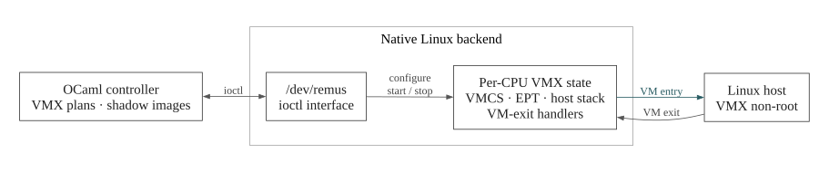
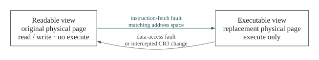

https://github.com/user-attachments/assets/71243f17-1b1d-4abc-a153-23d45fc758d0

VT-x hypervisor with an OCaml control plane whereby it checks processor capabilities and relocates instructions for hooks while the kernel module maintains per processor VMCS and EPT state and handles VM exits

## Design

  

The controller passes VMX control plans to the module through `/dev/remus` after checking the capabilities reported by each processor while the module owns the pinned pages and allocates the per CPU VMCS and EPT structures. A VM exit runs native code without entering the OCaml runtime

  

An instruction fetch fault selects the replacement page when cr3 identifies the target process while a data-access fault restores the original page, with intercepted cr3 changes resetting the view and process matching accounting for Linux PTI
